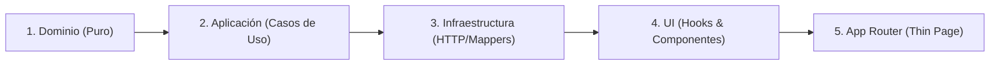

# Regla de Desarrollo Secuencial Atómico y Micro-Tareas — Squad 4

Este documento establece la directriz obligatoria para abordar cualquier requerimiento de desarrollo en el proyecto `web-diplomado`. El objetivo es garantizar **diffs pequeños, revisiones sencillas, cero deuda técnica acumulada y trazabilidad absoluta**.

---

## 1. Principio Fundamental: Prohibición de "Big-Bang"

Queda terminantemente prohibido generar módulos, pantallas completas o flujos multicapa en una única respuesta o commit masivo. 

> **Regla de Oro:**  
> Ninguna funcionalidad se implementa de golpe. Todo requerimiento debe dividirse en **micro-tareas atómicas** correspondientes a las capas de la Arquitectura Hexagonal y ejecutarse **una sola a la vez**.

---

## 2. Protocolo Obligatorio en 3 Fases

### Fase 1: Desglose y Planificación Previa (Checklist)
Antes de redactar código de una nueva funcionalidad o refactor significativo, el agente **DEBE**:
1. Analizar el requerimiento en el contexto del módulo (`src/modules/<feature>/`).
2. Presentar un checklist numerado de micro-tareas ordenadas según las capas hexagonales:
   - `[ ] 1. Dominio`: Entidades puras y puertos de repositorio (`*Repository.ts`).
   - `[ ] 2. Aplicación`: Casos de uso puros con inyección de dependencias.
   - `[ ] 3. Infraestructura`: DTOs, mappers, cliente HTTP y registro en `composition.ts`.
   - `[ ] 4. UI / Hooks`: Schemas Zod de formulario, hooks de estado (React Query / Zustand).
   - `[ ] 5. UI / Componentes`: Componentes semánticos reutilizables de la vista.
   - `[ ] 6. App Router`: Montaje de *Thin Page* (`page.tsx`), `loading.tsx` y `error.tsx`.
3. Aguardar la confirmación del desarrollador antes de iniciar la escritura de código.

### Fase 2: Ejecución Unitaria (De a una micro-tarea)
* El agente abordará **única y exclusivamente la micro-tarea activa**.
* Cada paso debe producir un diff mínimo, enfocado y autocontenido (idealmente $\le 50 - 80$ líneas de código).
* Cero placeholders: El código de esa capa debe ser completo, tipado estrictamente y funcional según su contrato.

### Fase 3: Entrega, Verificación y Commit
Al finalizar cada micro-tarea, el agente debe:
1. Resumir brevemente qué archivo se creó o editó y qué responsabilidad asume.
2. Actualizar el estado visual del checklist (`[x]` en la tarea completada).
3. Sugerir el mensaje de commit convencional atómico (ej: `feat(branches): define domain entity and repository port`).
4. Solicitar autorización para pasar a la siguiente micro-tarea.

---

## 3. Secuencia Hexagonal Invariable

El orden de construcción es estrictamente **de adentro hacia afuera**:

* **No saltarse capas:** No se crean componentes de UI ni páginas sin que existan previamente sus casos de uso y puertos de infraestructura.
* **Aislamiento de errores:** Si la capa de dominio o aplicación tiene un error de diseño o tipado, debe corregirse de inmediato antes de escribir infraestructura o UI.

---

## 4. Prohibiciones Explícitas

* ❌ **PROHIBIDO** crear simultáneamente el repositorio HTTP, el hook y el formulario en una misma respuesta si el usuario no lo ha aprobado explícitamente.
* ❌ **PROHIBIDO** avanzar a la siguiente subtarea si la actual genera errores en el compilador de TypeScript (`pnpm tsc --noEmit`).
* ❌ **PROHIBIDO** dejar implementaciones vacías o métodos `throw new Error("Not implemented")` para simular avance. Todo paso entregado debe estar terminado.
