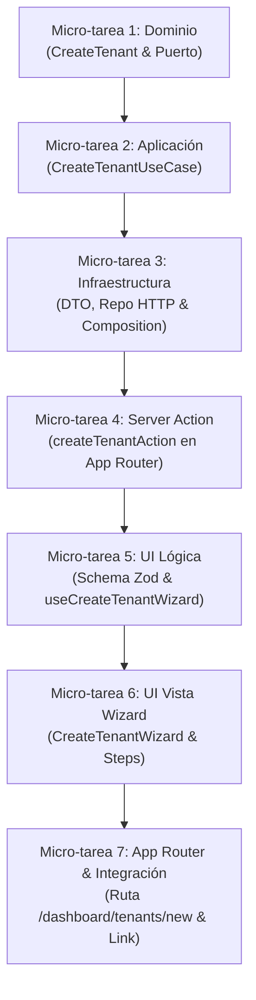

# Plan de Implementación — Issue #2

> **Issue:** [#2 - feat(tenants): implementar caso de uso, formulario y modal para alta de nuevas empresas](https://github.com/Neid-09/web-diplomado/issues/2)  
> **Decisión UX/UI:** Vista dedicada completa (`/dashboard/tenants/new`) con flujo guiado tipo Wizard por pasos (Alternativa A: Wizard Centrado).  
> **Estrategia:** Trunk-Based Development (TBD) + Desarrollo Secuencial Atómico Hexagonal (Squad 4).  
> **Estado:** 🚀 En ejecución  

---

## 1. Análisis Técnico y de Negocio

### 🎯 Propósito y Experiencia de Usuario
Permitir al usuario con rol **`OWNER`** registrar una nueva organización cliente (*tenant*) con todos sus datos legales, de contacto y de régimen tributario mediante una **vista completa dedicada (`/dashboard/tenants/new`)**, evitando la saturación de un modal y estructurando la captura en un **flujo guiado por pasos (Wizard Centrado)** con botón para volver atrás, validación por etapas y resumen de confirmación antes del envío final.

### 🔌 Contrato API (Swagger Backend Squad 1)
* **Endpoint:** `POST /api/v1/tenants`
* **Headers:** `Authorization: Bearer <token>`, `Content-Type: application/json`
* **Payload (`CreateTenantDto`):**
  * `nitRut` (*string*, requerido): NIT o RUT con dígito de verificación.
  * `businessName` (*string*, requerido): Razón social legal.
  * `tradeName` (*string*, requerido): Nombre comercial visible.
  * `address` (*string*, requerido): Dirección física principal.
  * `phone` (*string*, requerido): Teléfono de contacto (10 dígitos).
  * `email` (*string*, requerido): Correo corporativo legal.
  * `countryCode` (*string*, opcional, default `"COL"`).
  * `currencyCode` (*string*, opcional, default `"COP"`).
  * `taxRegime` (*enum*, opcional): `REGIMEN_SIMPLE` | `RESPONSABLE_IVA` | `NO_RESPONSABLE_IVA` | `GRAN_CONTRIBUYENTE` | `REGIMEN_ESPECIAL`.
* **Respuestas esperadas:**
  * `201 Created`: Devuelve el objeto `TenantDto` recién creado.
  * `400 Bad Request`: Error de formato o campos requeridos faltantes.
  * `409 Conflict`: Empresa ya registrada con ese NIT o correo electrónico.

### 🎨 Diseño UX — Alternativa A: Wizard Centrado en Vista Completa
* **Ruta dedicada:** `/dashboard/tenants/new` (protegida con `requireRole` en App Router).
* **Navegación:** Enlace superior `< Volver al Directorio de Empresas` hacia `/dashboard/tenants`.
* **Etapas del Wizard:**
  * **Paso 1: Identificación Legal y Comercial** (NIT/RUT, Razón Social, Nombre Comercial).
  * **Paso 2: Ubicación y Contacto Directo** (Dirección, Teléfono de 10 dígitos, Correo Corporativo).
  * **Paso 3: Parámetros Fiscales y Moneda** (Régimen Fiscal DIAN, País, Moneda).
  * **Paso 4: Resumen y Confirmación** (Ficha de pre-visualización antes de emitir la petición POST).
* **Transición hacia Issue #3:** Al crearse exitosamente, se muestra feedback de éxito y opción de redirigir al directorio o continuar a la asignación de su Administrador General.

---

## 2. Plan de Micro-Tareas y Commits Atómicos (Checklist TBD)

---

### [x] Micro-tarea 1: Capa de Dominio (Tipos y Contratos Limpios)
* **Archivos modificados:**
  * `src/modules/tenants/domain/tenant.entity.ts`: Se definió la estructura de dominio limpia `CreateTenant` y se simplificó la entidad `Tenant` (eliminando cualquier sufijo `Props`).
  * `src/modules/tenants/domain/tenant.repository.ts`: Se extendió el puerto `TenantRepositoryPort` con el método `create(data: CreateTenant): Promise<Tenant>`.
  * `src/app/(dashboard)/dashboard/tenants/actions.ts`: Actualizado para consumir el tipo puro `Tenant`.
* **Responsabilidad:** Definir el contrato puro del negocio sin dependencias externas ni sufijos técnicos.
* **Commit propuesto:** `feat(tenants): definir contrato limpio de creacion en dominio y extender puerto`

---

### [x] Micro-tarea 2: Capa de Aplicación (Caso de Uso Puro)
* **Archivo creado:**
  * `src/modules/tenants/application/create-tenant.use-case.ts`: Implementada la función pura `createTenantUseCase(tenantRepository: TenantRepositoryPort)` con validación y saneamiento de campos esenciales (NIT, razón social, email a minúsculas, códigos por defecto).
* **Responsabilidad:** Orquestar la creación de una empresa recibiendo el puerto por inyección de dependencias.
* **Commit propuesto:** `feat(tenants): implementar caso de uso para registro de empresas`

---

### [ ] Micro-tarea 3: Capa de Infraestructura (DTO, HTTP & Composition Root)
* **Archivos a modificar:**
  * `src/modules/tenants/infrastructure/tenant.dto.ts`: Agregar `createTenantRequestSchema` y tipo `CreateTenantRequestDto`.
  * `src/modules/tenants/infrastructure/http-tenant.repository.ts`: Implementar el método `create(data: CreateTenant)` usando `httpClient.post`, validando y relanzando errores específicos (incluyendo conflicto 409).
  * `src/modules/tenants/infrastructure/composition.ts`: Registrar `createTenant` en el objeto expuesto `tenantsUseCases`.
* **Responsabilidad:** Conectar el contrato de dominio con la API real `/api/v1/tenants` de Squad 1.
* **Commit propuesto:** `feat(tenants): implementar adaptador http para post de empresas y registrar en composition`

---

### [ ] Micro-tarea 4: Server Action (Capa de Frontera en Servidor)
* **Archivo a modificar:**
  * `src/app/(dashboard)/dashboard/tenants/actions.ts`: Agregar `createTenantAction(payload: CreateTenant)` garantizando ejecución en el entorno servidor con credenciales HttpOnly y control RBAC.
* **Responsabilidad:** Proveer un puente seguro tipado para que los componentes cliente invoquen la mutación.
* **Commit propuesto:** `feat(tenants): agregar server action para creacion segura de empresas`

---

### [ ] Micro-tarea 5: UI Lógica (Schema de Formulario y Custom Hook de Wizard)
* **Archivos a crear:**
  * `src/modules/tenants/ui/schemas/create-tenant.schema.ts`: Esquema Zod de validación por etapas (NIT/RUT, teléfono de 10 dígitos, email, régimen).
  * `src/modules/tenants/ui/hooks/use-create-tenant.ts`: Custom hook que encapsula el estado del paso activo, la validación con React Hook Form, la mutación con TanStack Query y la invalidación de la caché `['tenants']`.
* **Responsabilidad:** Orquestar el estado reactivo del formulario por etapas en el cliente.
* **Commit propuesto:** `feat(tenants): agregar esquema de validacion y custom hook para wizard de empresas`

---

### [ ] Micro-tarea 6: UI Componentes (Wizard Centrado por Pasos)
* **Archivos a crear en `src/modules/tenants/ui/components/`:**
  * `create-tenant-wizard.tsx`: Contenedor principal con barra de progreso, navegación entre pasos y control de submit.
  * Pasos semánticos: datos de identificación, contacto y parámetros fiscales, más tarjeta de resumen previo.
* **Responsabilidad:** Renderizar la vista guiada sin `useEffect`, con semántica HTML5 y tokens de diseño oficiales.
* **Commit propuesto:** `feat(tenants): implementar componentes visuales del wizard de creacion por pasos`

---

### [ ] Micro-tarea 7: App Router y Enlace en Directorio
* **Archivos a crear/modificar:**
  * `src/app/(dashboard)/dashboard/tenants/new/page.tsx`: Vista Thin Page con `requireRole()`.
  * `src/app/(dashboard)/dashboard/tenants/new/loading.tsx`: Skeleton del Wizard.
  * `src/app/(dashboard)/dashboard/tenants/new/error.tsx`: Error Boundary con reintento.
  * `src/app/(dashboard)/dashboard/tenants/page.tsx`: Actualizar el botón *"Nueva Empresa"* como un `Link` directo a `/dashboard/tenants/new`.
* **Responsabilidad:** Conectar la ruta completa en Next.js App Router y verificar compilación a producción.
* **Commit propuesto:** `feat(tenants): integrar ruta de creacion en app router y habilitar enlace en directorio`
